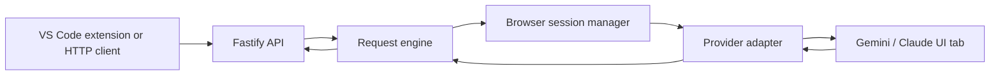

# MakingYourAiUnlimted

Browser-backed AI bridge for VS Code and local HTTP clients.

The project lets you keep authentication inside a real browser session while your local API and VS Code extension handle prompts, code edits, and assistant responses. You can use it with a live Gemini tab, with Claude, or with a fake browser UI for smoke testing.

## What this project is

This repository contains a local-first AI bridge made of three pieces:

- a Fastify HTTP API
- a browser session manager that talks to real provider tabs
- a VS Code extension that sends prompts or selected code to the backend

The goal is simple: give you a local coding assistant workflow where the model runs through a browser session you control.

## What you can do with it

- Ask general coding questions from VS Code
- Explain selected code
- Fix selected code in place
- Refactor selected code
- Optimize selected code
- Send direct API requests with `curl` or other tools
- Test the flow against a fake UI before using a real provider
- Attach to a live Gemini tab through Chrome remote debugging

## How it works

The backend does not talk to Gemini or Claude through a secret API key. Instead, it uses a browser session that is already signed in.

1. You start Chrome with remote debugging enabled.
2. You open the provider page, such as Gemini.
3. The API discovers that tab through Chrome DevTools Protocol.
4. The request engine serializes work so one browser tab is used at a time.
5. The provider adapter writes your prompt into the page and reads the response back.
6. The VS Code extension turns that into a coding workflow inside your editor.

## Architecture



Core responsibilities:

- `src/app.ts` exposes the HTTP routes
- `src/request-engine.ts` queues and executes requests one at a time
- `src/session-manager.ts` discovers and leases browser tabs
- `src/providers/gemini-adapter.ts` and `src/providers/claude-adapter.ts` control provider-specific browser UI behavior
- `extensions/vscode/src/extension.ts` turns the backend into editor commands

## Tech stack

- TypeScript
- Node.js 20+
- Fastify for the HTTP API
- Zod for request validation
- Playwright for browser automation
- VS Code extension API for editor integration
- Node test runner for automated tests

## Repository layout

```text
src/                 API, browser session handling, adapters, and request engine
test/                Node-based tests for adapters and request flow
docs/                Architecture and provider design notes
extensions/vscode/   VS Code extension client
.vscode/             Debug, task, and workspace settings
```

## Requirements

- Node.js 20 or newer
- npm 10 or newer
- VS Code
- Google Chrome if you want real Gemini browser mode

## Setup

```powershell
cd C:\Users\Dell\Desktop\theFreeAi\MakingYourAiUnlimted
npm install
```

## Run the backend

### Real Gemini mode

Start Chrome with remote debugging, open Gemini, and sign in:

```powershell
& "C:\Program Files\Google\Chrome\Application\chrome.exe" `
	--remote-debugging-port=9222 `
	--user-data-dir="C:\temp\chrome-gemini-debug" `
	--new-window="https://gemini.google.com/app"
```

Then start the API:

```powershell
$env:BROWSER_PROVIDER = "gemini"
$env:BROWSER_CDP_URL = "http://127.0.0.1:9222"
npm start
```

Check the discovered browser sessions:

```powershell
curl.exe -sS http://127.0.0.1:8787/v1/sessions
```

### Fake UI mode

Use the fake UI when you want a local smoke test without a real provider tab:

```powershell
npm run fake-ui
$env:FAKE_UI_URL = "http://127.0.0.1:3001/fake-ai"
$env:BROWSER_HEADLESS = "true"
npm start
```

## Use the VS Code extension

Open the repository root in VS Code and press F5. That launches the extension host using [.vscode/launch.json](.vscode/launch.json).

The workspace defaults are already set in [.vscode/settings.json](.vscode/settings.json):

- `browserAiBridge.url = http://127.0.0.1:8787`
- `browserAiBridge.model = gemini-ui`

In the new Extension Development Host window, open the Command Palette and run one of these commands:

- Browser AI Bridge: Ask
- Browser AI Bridge: Explain Selection
- Browser AI Bridge: Fix Selection
- Browser AI Bridge: Refactor Selection
- Browser AI Bridge: Optimize Selection

For selection-based commands, highlight code first. The extension sends selection-based requests to `POST /v1/code`, and freeform prompts to `POST /v1/chat/completions`.

## API surface

Useful routes:

- `GET /v1/health`
- `GET /v1/models`
- `GET /v1/sessions`
- `GET /v1/requests`
- `GET /v1/requests/:requestId`
- `POST /v1/requests/:requestId/cancel`
- `POST /v1/chat/completions`
- `POST /v1/code`

## Project commands

```powershell
npm run dev
npm run build
npm run build:all
npm test
npm run extension:build
```

## Testing

The test suite covers adapter behavior, request orchestration, session discovery, and API contracts. Tests live in [test/](test) and run with the Node test runner.

## Design principles

- Keep browser authentication in the browser
- Keep the backend local-first
- Serialize requests per browser tab
- Prefer explicit provider adapters over hidden provider-specific logic
- Preserve raw assistant output for code extraction and replay

## More docs

For the deeper technical design, see:

- [docs/architecture.md](docs/architecture.md)
- [docs/provider-adapter.md](docs/provider-adapter.md)

For the VS Code integration, see:

- [extensions/vscode/package.json](extensions/vscode/package.json)
- [extensions/vscode/src/extension.ts](extensions/vscode/src/extension.ts)