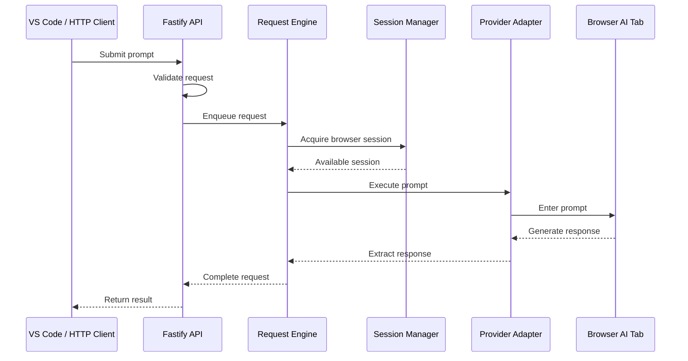
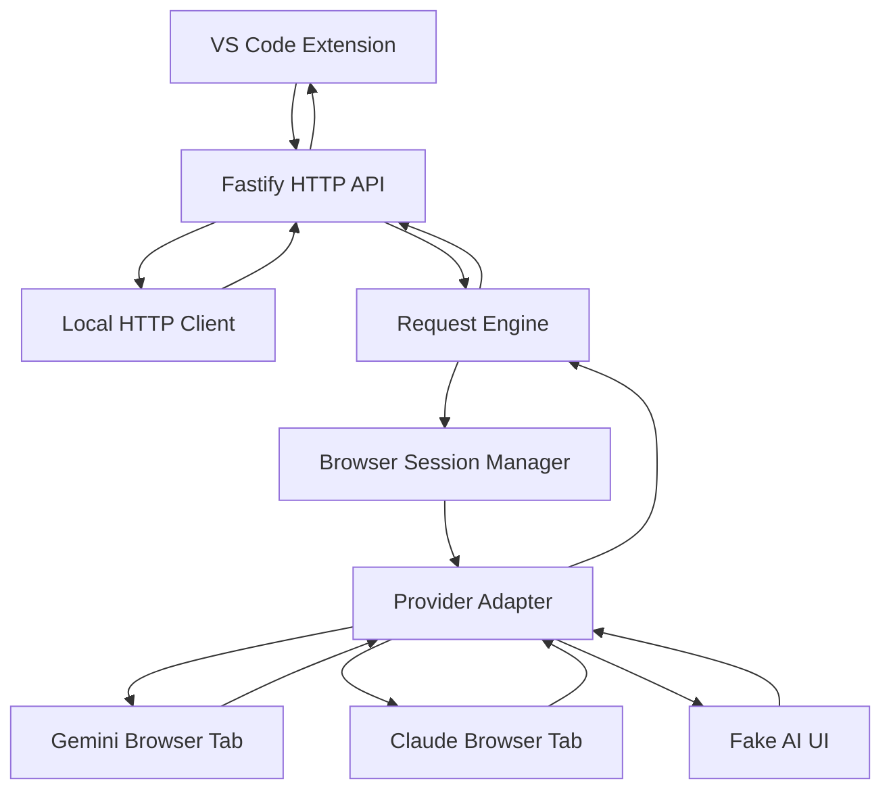

# MakingYourAiUnlimted

### Your browser. Your AI session. Your coding workflow.

**MakingYourAiUnlimted** is a local-first AI bridge that connects browser-based AI assistants to VS Code and local HTTP clients. It lets you use an authenticated browser session with providers such as Gemini or Claude to ask coding questions, understand code, fix bugs, refactor implementations, and optimize selected code—all through a local API.

Instead of connecting directly to a provider through an API key, the project uses browser automation to interact with an AI assistant that you have already signed in to.

> **Core idea:** Bring browser-based AI into your local development workflow through a reusable HTTP API and a VS Code extension.

---

## Table of Contents

- [Overview](#-overview)
- [Why MakingYourAiUnlimted](#-why-makingyouraiunlimted)
- [Features](#-features)
- [How It Works](#-how-it-works)
- [Architecture](#-architecture)
- [Technology Stack](#-technology-stack)
- [Project Structure](#-project-structure)
- [Prerequisites](#-prerequisites)
- [Getting Started](#-getting-started)
- [Running with Gemini](#-running-with-gemini)
- [Running with Fake UI](#-running-with-fake-ui)
- [VS Code Extension](#-vs-code-extension)
- [HTTP API Reference](#-http-api-reference)
- [Development Commands](#-development-commands)
- [Testing](#-testing)
- [Configuration](#-configuration)
- [Security and Privacy](#-security-and-privacy)
- [Troubleshooting](#-troubleshooting)
- [Roadmap](#-roadmap)
- [Documentation](#-documentation)
- [Contributing](#-contributing)
- [License](#-license)

---

## Overview

Modern AI assistants are useful for software development, but switching between your editor and a browser can interrupt your workflow.

MakingYourAiUnlimted bridges that gap.

It provides three main components:

| Component | Responsibility |
|---|---|
| **Fastify API** | Receives prompts and exposes local HTTP endpoints. |
| **Browser Session Manager** | Discovers and manages browser tabs through Chrome DevTools Protocol. |
| **VS Code Extension** | Sends prompts and selected code to the local backend. |

The backend coordinates these components so requests can be processed through a browser-based AI session.

### Supported workflows

- Ask general programming questions from VS Code.
- Explain selected code without leaving the editor.
- Request fixes for selected code.
- Refactor existing implementations.
- Optimize code for readability or performance.
- Submit requests using `curl` or another HTTP client.
- Test request handling through a fake AI interface.
- Connect to an authenticated Gemini browser tab using Chrome remote debugging.

The repository includes a provider-adapter design intended to separate provider-specific browser interactions from the core request-processing logic.

---

## Why MakingYourAiUnlimted?

### One local interface for browser-based AI

Instead of building every editor feature around a provider-specific API integration, the project exposes a local interface that can be reused by different clients.

**Without the bridge**

VS Code → Switch to browser → Enter prompt → Copy response → Return to editor

**With the bridge**

VS Code → Local AI bridge → Browser AI session → Response in VS Code

### Design goals

- **Local-first:** Run the backend on your own machine.
- **Browser-based authentication:** Keep provider sign-in within the browser session.
- **Editor integration:** Bring AI-assisted coding actions into VS Code.
- **Provider separation:** Keep browser-specific logic inside dedicated adapters.
- **Request coordination:** Queue work when a browser tab can process only one request at a time.
- **Testability:** Exercise the workflow with a fake UI before connecting a real provider.

---

## Features

### 1. AI-powered coding workflows

Use dedicated VS Code commands to interact with selected code or ask general programming questions.

| Command | Purpose |
|---|---|
| `Browser AI Bridge: Ask` | Submit a freeform prompt. |
| `Browser AI Bridge: Explain Selection` | Ask the assistant to explain highlighted code. |
| `Browser AI Bridge: Fix Selection` | Request a correction for highlighted code. |
| `Browser AI Bridge: Refactor Selection` | Request a cleaner implementation. |
| `Browser AI Bridge: Optimize Selection` | Request potential performance or efficiency improvements. |

Review generated changes before applying or committing them.

### 2. Browser-backed provider integration

The backend connects to a browser session through Chrome DevTools Protocol (CDP).

The browser remains responsible for the authenticated provider session, while the bridge handles request orchestration and response retrieval.

The current project documentation describes adapters for:

- **Gemini** — browser-based Gemini interaction.
- **Claude** — a separate provider adapter.
- **Fake UI** — a test interface for local smoke testing.

Provider compatibility depends on the corresponding adapter and the current structure of the provider's website.

### 3. Local HTTP API

The Fastify server allows clients other than VS Code to submit prompts and interact with the bridge.

This makes it possible to integrate the backend with:

- Terminal workflows.
- Custom scripts.
- Local developer tools.
- Other applications that can make HTTP requests.

### 4. Request management

The request engine coordinates browser-backed requests and serializes work so multiple requests do not compete for the same browser tab.

The API also exposes routes for inspecting requests and requesting cancellation.

Actual cancellation behavior depends on the implementation and the current state of the request.

### 5. Testable architecture

The fake UI allows you to validate basic request handling without relying on a live provider session.

Automated tests cover areas such as adapters, request orchestration, session discovery, and API contracts.

---

## How It Works

A typical request follows this sequence:

1. **Start the browser:** Launch Chrome with remote debugging enabled.
2. **Authenticate:** Open Gemini or another supported provider and sign in.
3. **Start the backend:** Run the Fastify API locally.
4. **Discover sessions:** The session manager connects to Chrome through CDP and identifies available provider tabs.
5. **Submit a request:** VS Code or an HTTP client sends a prompt to the backend.
6. **Queue the request:** The request engine coordinates execution.
7. **Interact with the provider:** The relevant adapter enters the prompt into the browser UI.
8. **Retrieve the response:** The adapter reads the resulting assistant response.
9. **Return the result:** The backend sends the response to the requesting client.

The exact interaction depends on the provider adapter.

### Request lifecycle



---

## Architecture



### Core modules

| Module | Responsibility |
|---|---|
| `src/app.ts` | Defines the HTTP API routes and application setup. |
| `src/request-engine.ts` | Coordinates and serializes request execution. |
| `src/session-manager.ts` | Discovers browser sessions and manages access to tabs. |
| `src/providers/gemini-adapter.ts` | Implements Gemini-specific browser interactions. |
| `src/providers/claude-adapter.ts` | Implements Claude-specific browser interactions. |
| `extensions/vscode/src/extension.ts` | Implements VS Code commands and communicates with the backend. |

### Architectural principles

- Separate transport, orchestration, session management, and provider-specific behavior.
- Validate incoming requests before execution.
- Avoid competing requests against the same browser tab.
- Preserve assistant output for downstream processing.
- Keep the core backend independent of individual editor commands.

---

## Technology Stack

| Technology | Usage |
|---|---|
| TypeScript | Main implementation language. |
| Node.js 20+ | Backend runtime. |
| Fastify | HTTP server and API routes. |
| Zod | Request validation. |
| Playwright | Browser automation. |
| Chrome DevTools Protocol | Browser debugging and session discovery. |
| VS Code Extension API | Editor integration. |
| Node.js Test Runner | Automated testing. |

---

## Project Structure

```text
MakingYourAiUnlimted/
│
├── src/
│   ├── app.ts
│   ├── request-engine.ts
│   ├── session-manager.ts
│   └── providers/
│       ├── gemini-adapter.ts
│       └── claude-adapter.ts
│
├── test/
│   └── ...
│
├── docs/
│   ├── architecture.md
│   └── provider-adapter.md
│
├── extensions/
│   └── vscode/
│       ├── package.json
│       └── src/
│           └── extension.ts
│
├── .vscode/
│   ├── launch.json
│   ├── settings.json
│   └── ...
│
├── package.json
└── README.md
```

*The tree highlights the principal documented files; additional files may exist in the repository.*

---

## Prerequisites

Before starting, ensure that you have:

- [Node.js](https://nodejs.org/) version 20 or newer.
- npm version 10 or newer.
- [Visual Studio Code](https://code.visualstudio.com/).
- [Google Chrome](https://www.google.com/chrome/) for real Gemini browser mode.
- A provider account and an authenticated browser session for the provider you want to use.

Verify your Node.js and npm installations:

```powershell
node --version
npm --version
```

---

## Getting Started

### 1. Clone or open the repository

If you already have the project locally, open its root directory.

```powershell
cd "C:\Users\Dell\Desktop\theFreeAi\MakingYourAiUnlimted"
```

If you are cloning the repository for the first time, use its actual Git URL:

```powershell
git clone <YOUR_REPOSITORY_URL>
cd MakingYourAiUnlimted
```

### 2. Install dependencies

```powershell
npm install
```

### 3. Build the backend

```powershell
npm run build
```

### 4. Run the tests

```powershell
npm test
```

Once the initial setup succeeds, choose either real Gemini mode or fake UI mode.

---

## Running with Gemini

This mode uses a real Gemini browser tab.

### Step 1: Launch Chrome with remote debugging

Run the following in PowerShell:

```powershell
& "C:\Program Files\Google\Chrome\Application\chrome.exe" `
  --remote-debugging-port=9222 `
  --user-data-dir="C:\temp\chrome-gemini-debug" `
  --new-window="https://gemini.google.com/app"
```

**Important:** The example uses a separate Chrome profile stored at `C:\temp\chrome-gemini-debug`. Sign in to Gemini in that profile if necessary.

Using a dedicated profile helps isolate the bridge from your everyday browsing profile.

### Step 2: Start the backend

In a separate PowerShell terminal, navigate to the repository root and run:

```powershell
$env:BROWSER_PROVIDER = "gemini"
$env:BROWSER_CDP_URL = "http://127.0.0.1:9222"

npm start
```

Keep this terminal open while using the bridge.

### Step 3: Check the API

Check whether the backend is responding:

```powershell
curl.exe -i http://127.0.0.1:8787/v1/health
```

Inspect the discovered browser sessions:

```powershell
curl.exe -sS http://127.0.0.1:8787/v1/sessions
```

Confirm that the expected Gemini tab is discoverable before submitting prompts.

### Step 4: Send a test prompt

The following example illustrates the expected chat-completion workflow:

```powershell
$body = @{
    model = "gemini-ui"
    messages = @(
        @{
            role = "user"
            content = "Explain the difference between an interface and an abstract class in TypeScript."
        }
    )
} | ConvertTo-Json -Depth 10

Invoke-RestMethod `
  -Uri "http://127.0.0.1:8787/v1/chat/completions" `
  -Method Post `
  -ContentType "application/json" `
  -Body $body
```

This example assumes the route accepts an OpenAI-style `messages` payload. Adjust it if the Zod schema in your current implementation defines a different request format.

---

## Running with Fake UI

Fake UI mode is useful when developing or debugging the request pipeline without interacting with a real AI provider.

### Step 1: Start the fake interface

Open a terminal in the repository root:

```powershell
npm run fake-ui
```

### Step 2: Configure the backend

Open another terminal:

```powershell
$env:FAKE_UI_URL = "http://127.0.0.1:3001/fake-ai"
$env:BROWSER_HEADLESS = "true"

npm start
```

### Step 3: Validate the workflow

Check the health endpoint:

```powershell
curl.exe -i http://127.0.0.1:8787/v1/health
```

Then submit a test prompt using the same HTTP request format as your real-provider workflow.

The fake interface is intended for testing the bridge's mechanics, not for generating genuine AI responses.

---

## VS Code Extension

The repository includes a VS Code extension that connects editor commands to the local backend.

### Launch the extension in development mode

1. Open the repository root in VS Code.
2. Open the Run and Debug panel.
3. Select the launch configuration defined in `.vscode/launch.json`.
4. Press **F5**.
5. In the Extension Development Host window, open the Command Palette.
6. Search for `Browser AI Bridge`.

### Available commands

#### Browser AI Bridge: Ask

Submit a freeform question without selecting code.

Example:

> Explain how JavaScript promises work, with a practical example.

#### Browser AI Bridge: Explain Selection

Highlight code, then request an explanation of its behavior, control flow, dependencies, or potential edge cases.

#### Browser AI Bridge: Fix Selection

Select code and request a fix for a specific bug or implementation problem.

Always review the proposed fix before using it.

#### Browser AI Bridge: Refactor Selection

Request improvements to code structure, readability, naming, or maintainability while preserving intended behavior.

#### Browser AI Bridge: Optimize Selection

Request a performance-oriented review and potential optimizations. Validate the output with tests and benchmarks when appropriate.

### Default settings

The documented workspace settings are:

```json
{
  "browserAiBridge.url": "http://127.0.0.1:8787",
  "browserAiBridge.model": "gemini-ui"
}
```

Keep the extension's configured backend URL aligned with the address and port used by the running server.

Selection-based commands use `POST /v1/code`, while freeform prompts use `POST /v1/chat/completions`.

---

## HTTP API Reference

The backend exposes the following documented routes.

| Method | Endpoint | Purpose |
|---|---|---|
| `GET` | `/v1/health` | Check API health. |
| `GET` | `/v1/models` | Inspect available model identifiers. |
| `GET` | `/v1/sessions` | Inspect discovered browser sessions. |
| `GET` | `/v1/requests` | Inspect tracked requests. |
| `GET` | `/v1/requests/:requestId` | Retrieve request information. |
| `POST` | `/v1/requests/:requestId/cancel` | Request cancellation. |
| `POST` | `/v1/chat/completions` | Submit a general chat request. |
| `POST` | `/v1/code` | Submit a code-oriented request. |

### Example: Check server health

```powershell
curl.exe -i http://127.0.0.1:8787/v1/health
```

### Example: Inspect available models

```powershell
curl.exe -sS http://127.0.0.1:8787/v1/models
```

### Example: Inspect browser sessions

```powershell
curl.exe -sS http://127.0.0.1:8787/v1/sessions
```

### Example: Inspect tracked requests

```powershell
curl.exe -sS http://127.0.0.1:8787/v1/requests
```

For exact request schemas, response formats, error codes, and cancellation semantics, consult the route definitions and validation schemas in the source code.

---

## Development Commands

| Command | Purpose |
|---|---|
| `npm run dev` | Start the development workflow configured by the project. |
| `npm start` | Start the configured backend entry point. |
| `npm run build` | Build the backend. |
| `npm run build:all` | Build all configured project components. |
| `npm test` | Run automated tests. |
| `npm run extension:build` | Build the VS Code extension. |
| `npm run fake-ui` | Start the fake AI interface. |

Run commands from the repository root unless the project scripts specify otherwise.

---

## Testing

The project uses Node.js's built-in test runner.

Run the complete test suite:

```powershell
npm test
```

Build the project:

```powershell
npm run build:all
```

### What to validate

- Provider adapters handle expected browser UI states.
- Browser sessions are discovered correctly.
- Requests are queued and executed in the expected order.
- API requests are validated against the expected schemas.
- Provider responses are returned to the caller.
- Errors are handled when a tab is unavailable or a response cannot be extracted.
- Cancellation requests behave correctly for queued and active work.
- The VS Code extension communicates with the backend.

For reliable regression testing, use fake UI mode for repeatable scenarios and real-provider testing for browser-specific behavior.

---

## Configuration

The project documents the following environment variables.

| Variable | Purpose | Example |
|---|---|---|
| `BROWSER_PROVIDER` | Selects the configured browser provider. | `gemini` |
| `BROWSER_CDP_URL` | Chrome DevTools Protocol endpoint. | `http://127.0.0.1:9222` |
| `FAKE_UI_URL` | URL of the fake AI interface. | `http://127.0.0.1:3001/fake-ai` |
| `BROWSER_HEADLESS` | Configures headless browser behavior where supported. | `true` |

Example Gemini configuration:

```powershell
$env:BROWSER_PROVIDER = "gemini"
$env:BROWSER_CDP_URL = "http://127.0.0.1:9222"
```

Example fake UI configuration:

```powershell
$env:FAKE_UI_URL = "http://127.0.0.1:3001/fake-ai"
$env:BROWSER_HEADLESS = "true"
```

These examples are for the current documented workflow. Check the implementation for additional settings and defaults.

---

## Security and Privacy

MakingYourAiUnlimted is designed around local browser sessions, but local execution does not automatically guarantee security.

### Protect your browser session

- Use a dedicated browser profile for bridge automation.
- Do not share browser profile directories or session data.
- Avoid signing in to sensitive accounts in a profile exposed to automation unless necessary.
- Close the debug-enabled browser when you are finished.

### Protect the debugging endpoint

Chrome remote debugging can grant extensive control over the browser, including access to authenticated sessions.

- Bind debugging to loopback on your own machine.
- Do not expose port `9222` to public networks.
- Do not forward the debugging port to untrusted hosts.
- Do not run the bridge against a browser profile you cannot safely expose to automation.

### Protect the local API

The documented examples use `127.0.0.1`, which is preferable to exposing the server publicly.

Before exposing the backend beyond localhost, implement and verify appropriate authentication, authorization, request limits, and network access controls.

### Review AI-generated code

AI responses may contain incorrect, insecure, or incomplete code. Review proposed changes, run tests, and inspect security-sensitive modifications before merging them.

### Follow provider terms

Browser automation behavior and acceptable usage may vary by provider. Review the applicable provider terms and policies before using the bridge extensively.

---

## Troubleshooting

### The API cannot find a browser session

1. Confirm Chrome is running.
2. Confirm the remote debugging port is correct.
3. Open the CDP endpoint locally:

   ```powershell
   curl.exe -i http://127.0.0.1:9222/json/version
   ```

4. Confirm that Gemini is open in the dedicated profile.
5. Check the backend logs for session discovery errors.

### The backend starts, but requests do not complete

- Confirm that the expected browser tab is available.
- Check whether another request is already using the same tab.
- Verify that the provider page has finished loading.
- Inspect adapter logs and request status.
- Check whether the provider's interface has changed.

### Gemini or Claude responses cannot be extracted

Provider adapters rely on browser UI behavior. Changes to page structure, selectors, loading indicators, or response rendering can break automation.

Inspect `src/providers/` and the provider-adapter documentation when debugging these failures.

### VS Code cannot reach the backend

1. Check that the backend is running.
2. Verify `browserAiBridge.url`.
3. Test the health endpoint directly.
4. Check the VS Code Extension Development Host logs.
5. Confirm that the configured port matches the server port.

### Fake UI mode does not work

- Start the fake UI before testing the backend.
- Confirm the fake interface is reachable at the configured URL.
- Verify the backend is using the intended provider configuration.
- Check terminal output for startup and navigation errors.

---

## Roadmap

Potential future improvements include:

- [ ] More robust provider response extraction.
- [ ] Improved handling of browser navigation and provider loading states.
- [ ] Better request progress and cancellation reporting.
- [ ] More detailed structured error messages.
- [ ] Provider capability discovery and health checks.
- [ ] Improved code-diff previews before applying edits.
- [ ] Configurable prompts for explain, fix, refactor, and optimize commands.
- [ ] Better automated tests for provider UI changes.
- [ ] Support for additional browser-based AI providers.
- [ ] Optional authentication for local API clients.
- [ ] Request history and configurable logging.

These are proposed improvements, not claims about features already implemented.

---

## Documentation

Explore the following project files for more detail:

- [`docs/architecture.md`](docs/architecture.md) — architecture and request flow.
- [`docs/provider-adapter.md`](docs/provider-adapter.md) — provider integration and adapter design.
- [`extensions/vscode/package.json`](extensions/vscode/package.json) — extension metadata and commands.
- [`extensions/vscode/src/extension.ts`](extensions/vscode/src/extension.ts) — VS Code integration.
- [`test/`](test/) — automated tests.

---

## Contributing

Contributions that improve reliability, testability, security, and developer experience are welcome.

A useful contribution workflow is:

1. Create a focused branch.
2. Make a small, clearly scoped change.
3. Add or update tests.
4. Run the test suite.
5. Run the relevant build commands.
6. Document any new configuration or behavior.
7. Submit a pull request describing the problem and solution.

For provider-adapter changes, include tests for loading states, response extraction, and expected failure scenarios wherever possible.

---

## License

No license information was provided in the project description.

Before distributing the repository publicly, add a `LICENSE` file that specifies the terms under which others may use, modify, and distribute the project.

---

**MakingYourAiUnlimted** — a local-first bridge between browser-based AI and your coding workflow.
